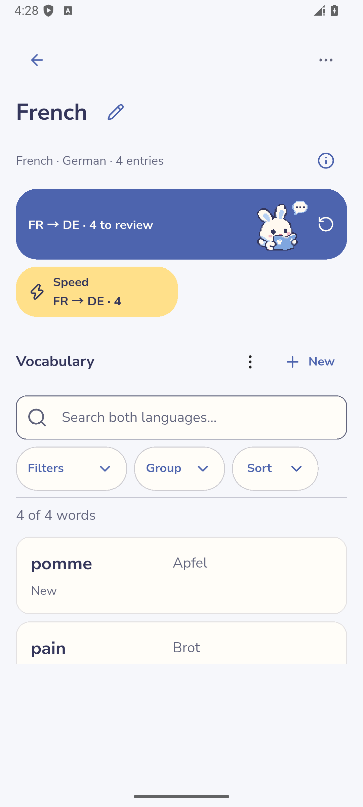
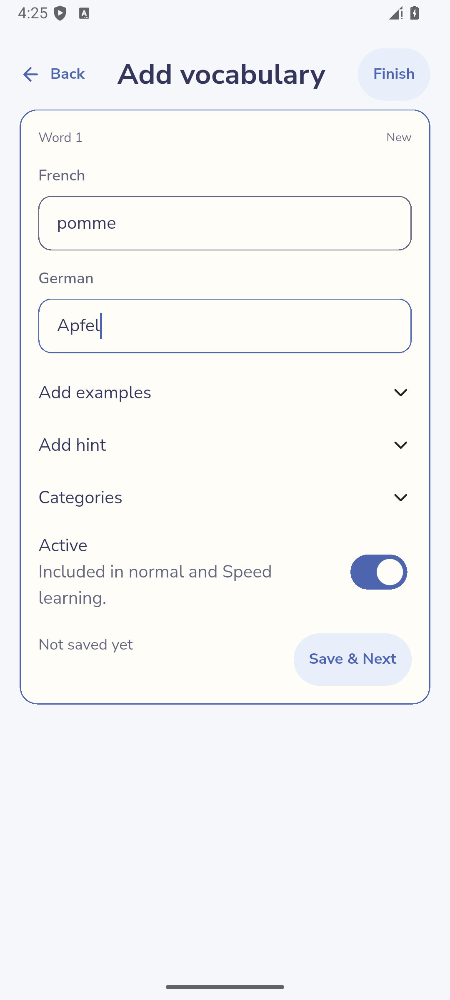
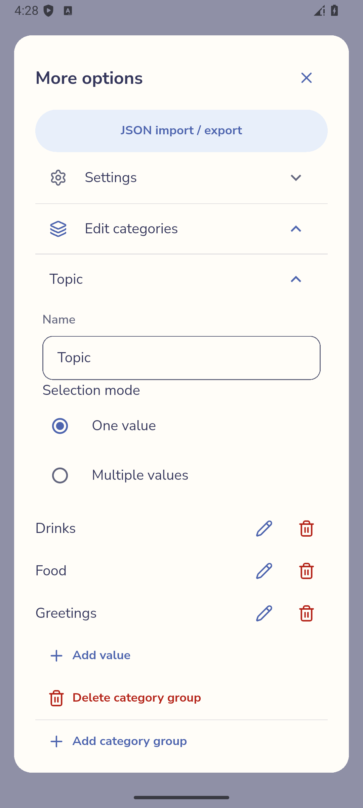
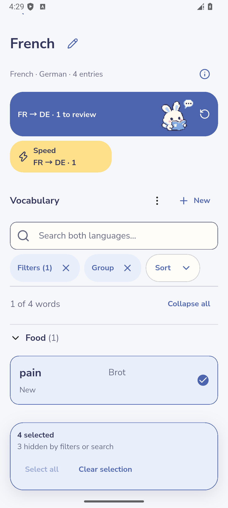
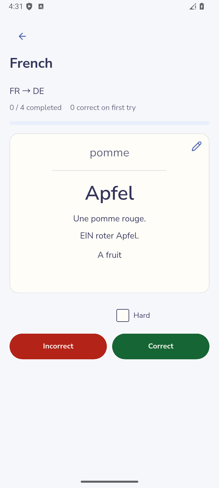
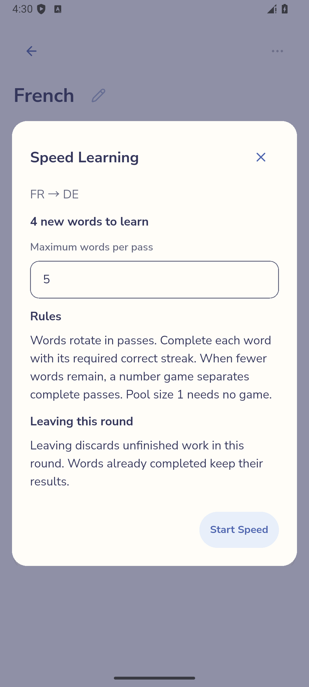
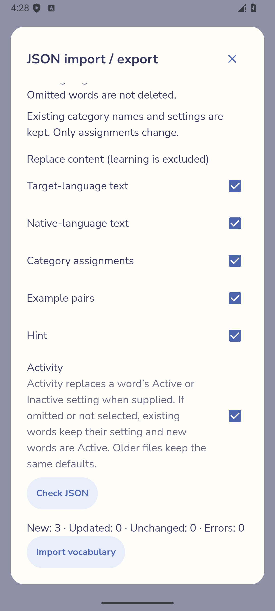
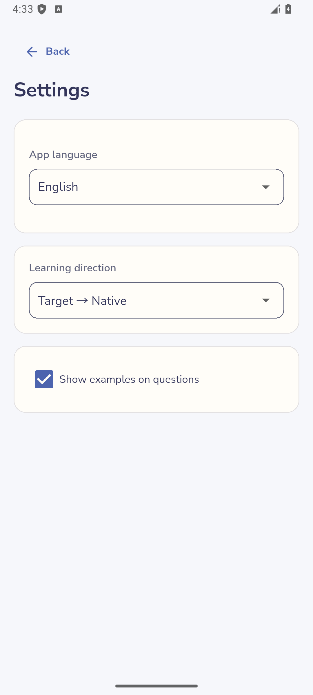

# Using Piko

Piko stores vocabulary on the device and offers self-assessed Long-term and Speed learning. This guide describes current implemented behavior. The [build manifest](build-manifest.json) identifies the earlier gallery APK; its screenshots do not yet show the statistics additions. [Verification coverage](verification.md) distinguishes observed product flows from source and test evidence. The [gallery](screenshots.md) shows the same ordinary application.

## Contents

- [Collections](#collections)
- [Add vocabulary](#add-vocabulary)
- [Edit and delete vocabulary](#edit-vocabulary)
- [Examples, hints and activity](#optional-content)
- [Categories](#categories)
- [Search, filter, group and sort](#list-controls)
- [Temporary selection](#selection)
- [Long-term learning](#long-term)
- [Speed learning](#speed)
- [Statistics](#statistics)
- [JSON import and export](#transfer)
- [Settings](#settings)
- [Glossary](#glossary)

## Collections

From Home, choose **New** or **Create first collection**. Select the target language you are learning and the native language used for translations, enter a Collection name, then choose **Create collection**. The languages must differ and the name cannot be empty. The available language choices are Korean, German, English and French; interface language is a separate setting.

Open a Collection from **My collections**. Its heading shows the language pair and vocabulary count. The information icon beside this metadata opens **How learning works**, including an expandable technical explanation. Closing help returns to the Collection.

Use the heading's rename control to change its name; save or cancel that edit explicitly. The Collection **More options** menu contains JSON import/export, Collection Settings, category editing and Collection deletion. Confirming deletion removes that Collection and its associated vocabulary/learning. Export anything you want to retain before deleting it; Collection deletion has no vocabulary-style Undo.

The app stores changes locally. There is no account, cloud synchronization or app-wide backup/restore flow in this build. Uninstalling the app or clearing its storage can remove local data. See [transfer](#transfer) for the narrower Collection JSON operation.

Ordinary product emulator capture · [Full image](images/06-collection-list.png) · [Capture metadata: `06-collection-list`](build-manifest.json)

[Technical ownership](technical.md#runtime) · [Home and Collection images](screenshots.md#collections)

## Add vocabulary

1. Open a Collection and choose **+ New** in its Vocabulary area (accessible name **Add Entry**), then **Manual entry** in the Add vocabulary chooser.
2. Enter a target word and its native translation in the new vocabulary card. Both are required.
3. Add optional content or categories as needed, then confirm with **Save & Next**. This creates a saved word and another draft for continuing entry.
4. Choose **Finish** to leave the session. If an unconfirmed draft remains, choose whether to continue editing or discard it. Already saved words remain saved.

A new draft is different from an existing saved card: completing both required fields alone does not confirm the new word. Once a word is saved, valid edits save automatically. Watch **Saving…**, **Saved** and validation/error feedback rather than assuming an invalid edit reached storage.

The same target/native pair cannot be saved twice in one Collection. Comparison trims outside whitespace, normalizes Unicode and ignores letter case; it does not merge all spelling variants. If a pair already exists, edit that saved entry or change the pair. Empty required fields and incomplete example pairs need correction before saving.

Ordinary product emulator capture · [Full image](images/03-entry-draft.png) · [Capture metadata: `03-entry-draft`](build-manifest.json)

[Editor image](screenshots.md#editors) · [Identity and validation](technical.md#vocabulary)

## Edit and delete vocabulary

Open a word's edit control from the Collection vocabulary list. The inline editor contains both words, optional examples/hint, categories and **Active**. Valid changes save automatically. Collapse the editor when finished. Invalid raw text remains visible for correction; collapsing is not a way to confirm an invalid value. On a storage error, retain the editor and use **Retry** where offered.

You can also edit the current word after revealing an answer in normal, retry or Speed learning. Return from the editor to the same revealed answer before grading. Editing vocabulary does not itself count as an answer or reset its scheduling. Making the current word inactive removes it from eligible learning according to the current session's refreshed state.

Use **Vocabulary actions → Delete vocabulary** to remove a word immediately. Use the short-lived **Undo** promptly to restore it. Deletion removes the word's directional learning and category associations. A failed or expired Undo must not be treated as a successful restoration. Collection deletion is a separate operation with confirmation.

[Editor image](screenshots.md#editors) · [Persistence and guarded writes](technical.md#storage)

## Examples, hints and activity

- **Add examples** opens example pairs, each containing the target-language sentence and native-language sentence. Complete both sides or leave the pair empty. Use **Add example pair** for another pair; removing a pair removes that optional content.
- **Add hint** opens a single hint. **Show hint automatically** controls whether it is visible during learning. When off, a hint can be revealed by tapping its control.
- In **More options → Settings**, a Collection can **Show hints automatically for new vocabulary**. This changes defaults for new words; existing words retain their own setting. An editor may offer to use a changed visibility choice for new words as well.
- **Active** includes a word in learning. Inactive words remain visible/editable in the Collection but are excluded from normal and Speed learning in both directions. Activity is independent of readiness and does not erase progress.

Each example side permits up to 1,000 characters and a hint up to 2,000. Changing optional content preserves the word's learning identity. The app-wide **Show examples on questions** setting affects question-side examples; it does not delete saved examples or change the answer's stored content.

Detailed cards expose more saved content than Compact cards. During learning, content follows the question/answer language and hint visibility. A missing hint/example is simply absent, rather than a required field.

[Content rules](technical.md#vocabulary) · [Settings](#settings)

## Categories

Open **More options → Edit categories** within a Collection. Choose **Add category group** for a dimension such as “Topic”, choose **One value** or **Multiple values**, then add its values. One value permits one assignment for each word; Multiple values permits several. Names and values belong to this Collection. Expand a category group to edit its name, selection mode and values.

Assign values from a vocabulary editor. Values are shown alphabetically. Manage a dimension or value from the category page to rename or delete it. Deleting category metadata removes the relevant assignments rather than deleting vocabulary. Changing a Multiple dimension to Single can require resolving assignments; follow the app's conflict feedback instead of assuming a value was chosen for you.

Categories feed the list's filters and grouping. If none exist, the category/filter area explains that state; create category definitions before expecting values to select.

Ordinary product emulator capture · [Full image](images/07-categories.png) · [Capture metadata: `07-categories`](build-manifest.json)

[Category image](screenshots.md#categories) · [Category ownership](technical.md#queries)

## Search, filter, group and sort

The Collection vocabulary area has a search field and separate **Filters**, **Group** and **Sort** controls. These affect the displayed list without modifying the words.

| Control | Use and result |
| --- | --- |
| Search | Match saved target/native text. Clear the query to recover words hidden by search. |
| Filters | Stage category selections, then **Apply**. Values within one dimension are alternatives; different dimensions must all match. **Clear filters** clears the pending filter selection. Dismissing without Apply keeps the applied filters. |
| Group | Choose one category dimension or **Ungrouped**, then Apply. Expand/collapse group headers individually or use the list menu's **Expand all / Collapse all**. A word assigned to multiple values can appear in multiple groups. |
| Sort | Choose Original order, target/native A–Z or Z–A, or newest/oldest. Apply the choice. Older words without a recorded added date remain undated rather than receiving invented dates. |
| List options | Change **Layout** between Compact and Detailed, and change **Language order** independently of the learning direction. |

Controls expose their current state and independent reset actions. Search and filters combine; changing Group or Sort does not clear them. An empty result is not deletion: clear search/filter restrictions to locate saved words again. View preferences are retained per Collection; temporary selection is separate.

Collection Detail's learning launch availability uses the matching eligible vocabulary and configured direction, so filtering/searching can change the offered actions and counts. The Home review badge counts distinct due vocabulary across directions; completing one direction can leave the opposite direction due. A grouped duplicate is still one saved word.

[List image](screenshots.md#collections) · [Query and ordering details](technical.md#queries)

## Temporary selection

Hold a collapsed vocabulary card to start selection, then tap cards to toggle them. **Select all** includes the current search/filter matches, including words inside collapsed groups. A grouped word is selected once by identity even when displayed in several places.

Changing search/filter can hide selected words without deselecting them. The selection summary reports hidden selections. Use **Clear selection** to end selection explicitly; leaving the Collection also clears it.

Use **Speed · selected** in the selection controls to practice the selected active words, including hidden and previously learned words. Setup reports included, hidden, inactive and unavailable words. Cancel retains selection and scroll position; entering the round clears the temporary selection. Selection has no bulk edit/delete/export operation and does not change Active/Inactive or saved filters.

Ordinary product emulator capture · [Full image](images/10-hidden-selection.png) · [Capture metadata: `10-hidden-selection`](build-manifest.json)

[Selection image](screenshots.md#selection) · [Selection ownership](technical.md#queries)

## Long-term learning

1. Open a Collection with active vocabulary due in the desired direction. Tap its directional review card (for example **FR → DE · 4 to review**); choose a direction when the app offers a choice.
2. Read the question and recall the answer. Tap the card to reveal it. Reveal a hidden hint if needed.
3. Choose **Incorrect** if you did not recall it, or **Correct** if you did. For a difficult correct answer, select **Hard** before Correct.
4. Continue through the available regular questions and repetitions. The progress display distinguishes completion from correct-on-first-try.

Correct schedules a later review. Hard plus Correct uses the scheduler's Hard rating; Incorrect uses Again and creates an extra repetition obligation for this learning day. Repetitions are separated by other graded questions where available. When none can fill the gap, the app can show a short countdown before the next repetition. A repeated answer does not create another normal scheduled-review event.

**Correct previous review** lets you replace the immediately previous grade while its correction control is available. Choose the corrected grade for that answer. This replaces its effect rather than adding an extra ordinary review. It is not a general learning-history editor.

When the captured work and repetitions are complete, the existing summary shows the completed counts and a decorative celebration Piko. Dismiss it to return to the Collection. **Exit review** leaves earlier saved answers intact. A save error keeps the operation unresolved; retry the grade instead of counting it as saved. **Nothing due right now** means the current scope has no eligible scheduled work, not that the vocabulary is mastered.

The Collection's information icon explains scheduling and repetitions. Readiness labels such as New, Retry pending, Due now and Next review are scheduling information. The build does not offer typed-answer assessment or automatic knowledge-level/mastery grading. Learning is independent for target → native and native → target.

Ordinary product emulator capture · [Full image](images/14-long-term-answer.png) · [Capture metadata: `14-long-term-answer`](build-manifest.json)

[Learning image](screenshots.md#learning) · [Scheduler, retry and correction](technical.md#learning)

## Speed learning

Use a Collection's directional **Speed** action when eligible active words are available. The default pool comes from new words matching the current scope; temporary selection does not replace it. Read the setup's word count, direction and rules. Set **Maximum words per pass** and choose **Start Speed**.

For selected practice, use the separate selection action. A single preferred direction opens setup directly; when both directions are enabled, choose one. Start rechecks the whole selected set in the current Collection sort order, including hidden words. Inactive or deleted words are excluded. Changed counts remain visible for review before starting; failures retain setup and pool size for retry. No eligible words means no start. Previously reviewed or Speed-completed words remain eligible for this explicit practice.

Reveal each answer and choose Correct or Incorrect. A word finishes after a consecutive correct streak: one correct with no errors, two after one error, three after two, and four after three or more. An error resets that word's streak. Completed words leave the pool; waiting words enter as space becomes available. A short numbers game can interrupt unfinished work between passes. The session ends without an extra game once all work is complete.

Speed completion persists word-by-word. Completing a word preserves Long-term scheduling, history and pending repetitions in both directions, including after errors. Each completed word direction contributes at most once to that learning day's Speed statistics. Leaving before a word completes does not count that unfinished word as complete. In-memory pool/streak state is not a resumable saved session.

After every word has successfully saved its completion, Speed returns to the Collection with its completed-word message and one celebration Piko, temporarily replacing the reading pose. Dismiss the message with X; it also clears when another learning launch starts or when leaving the Collection. Exit, initially empty work, failed saves and exhaustion caused only by deactivation do not celebrate. No extra summary or timer is added.

Ordinary product emulator capture · [Full image](images/12-speed-setup.png) · [Capture metadata: `12-speed-setup`](build-manifest.json)

[Speed images](screenshots.md#speed) · [Speed state and persistence](technical.md#speed)

## Statistics

Home shows **Activity** above Collections. Open its card for **Statistics**, with Long-term selected initially and a separate Speed view. Activity remains accessible after deleting all Collections if recorded learning remains. A new installation with no Collections or activity keeps the ordinary empty Home.

**Vocabulary learned** counts successfully saved regular Long-term answers, including repeated words and both directions. It does not measure distinct words or mastery. Grade correction keeps the original credit; retry answers do not add another regular answer. The streak counts consecutive learning days with at least one regular answer. With no answer today, yesterday's streak remains open and a reminder appears. The average uses positive-count active days within the last 30 learning days, including today; it is absent when there are none.

Daily activity starts with seven recent days. **Show calendar** opens a Monday-first month calendar; browse previous months or choose a month and year. Future months are unavailable. A dash means unrecorded history, zero means a recorded idle day, and an asterisk marks partial coverage. **Statistics recorded since** identifies the start; earlier activity is not reconstructed from old or imported learning.

A learning day changes at local **04:00**. Saved activity retains its assigned date through later timezone changes. A backwards clock change temporarily hides future-dated activity. Statistics refresh after learning, opening, resuming, system clock changes and the day boundary. Loading and errors have explicit status; a failed refresh labels retained values as potentially out of date and offers retry.

Speed shows today's successful word-direction completions, counted once per word, direction and learning day. Repeated completion can count on another day. Unfinished words contribute nothing; completed words keep their credit when a session is abandoned. Speed does not change the Long-term average or streak. Deleting vocabulary or Collections does not delete already recorded statistics.

## JSON import and export

Open **More options → JSON import / export** in the destination/source Collection. The Import and Export tabs operate on that one Collection.

### Export a Collection

On the Export tab, use **Copy JSON** or **Save JSON file** to generate and keep the current Collection export. The Android file picker owns the chosen destination and overwrite consent. If saving fails, a copyable JSON fallback is shown.

Export includes vocabulary, categories, optional content, activity and associated directional learning. It is not an app-wide backup. In particular, importing this export does not restore learning progress; keep that distinction in mind before deleting anything or moving devices.

### Check and apply an import

1. Use **Choose JSON file**, **Paste from clipboard**, or edit **Paste or edit JSON**. **Copy example JSON** supplies synthetic structure for the Collection's language pair.
2. Choose which content groups to import: target text, native text, category assignments, examples, hint and Activity.
3. Choose **Check JSON**. Review the new/updated/unchanged/error counts and row/path errors. Checking alone saves nothing.
4. Fix errors and check again. When valid, choose **Import vocabulary** and confirm the batch.

Files must be valid UTF-8 JSON within 1,000,000 bytes, use the Piko vocabulary format, contain exactly one Collection and match the destination language pair. Schema versions 1–4 are accepted. Existing IDs update selected content; absent selected groups leave existing content unchanged. New vocabulary requires both words. Conflicting identities, invalid categories or duplicate final word pairs block the batch.

Existing learning is preserved. Imported learning data is ignored; new entries receive fresh learning state. When Activity is absent or unselected, existing words keep their activity and new words are Active. Imported Collection identity/name does not rename or replace the destination Collection. A stale preview after another change requires **Check JSON** again. Failed apply saves no partial batch.

Ordinary product emulator capture · [Full image](images/05-import-preview.png) · [Capture metadata: `05-import-preview`](build-manifest.json)

[Import/export images](screenshots.md#transfer) · [Format and compatibility](technical.md#interchange)

## Settings

From Home, open **Settings**. Choose **App language** → English or Deutsch. The choice is saved and is separate from each Collection's vocabulary languages. The expandable Settings section inside a Collection's More options menu owns that Collection's Hint default instead.

**Learning direction** selects Target → Native, Native → Target, or Both directions separately. It affects eligible launch choices; it does not merge the two directions' progress. **Show examples on questions** changes question-side presentation while preserving stored examples.

Settings report loading/saving failures. If a preference cannot be saved, the app restores its previous choice and offers retry. Return using Back. Account/sync controls and a developer-settings interface are not available.

Ordinary product emulator capture · [Full image](images/20-settings.png) · [Capture metadata: `20-settings`](build-manifest.json)

[Settings image](screenshots.md#settings) · [Preference ownership](technical.md#runtime)

## Glossary

| Term | Meaning in this app |
| --- | --- |
| Collection | Named vocabulary container with one target/native language pair. |
| Target / Native | The learned language and translation language; not the interface locale. |
| Word / vocabulary entry | One saved target/native pair with a stable identity and optional content. |
| Example pair | Target and native example sentences attached to a word. |
| Hint | Optional text with per-word automatic/reveal visibility. |
| Category dimension / value | A Collection-owned classification and one of its selectable labels. |
| Active / Inactive | Inclusion/exclusion from learning, independent of readiness. |
| Direction | Target → Native or Native → Target, each with independent learning state. |
| Due / Retry pending | Scheduled availability or an outstanding same-day repetition, not mastery. |
| Long-term | Scheduled self-assessment using persisted direction-specific progress. |
| Speed | Pool-based consecutive-correct practice with completion effects per direction. |
