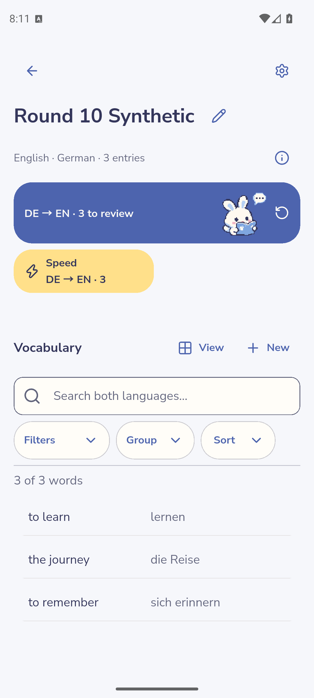
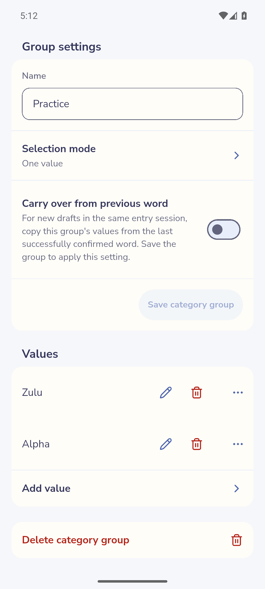
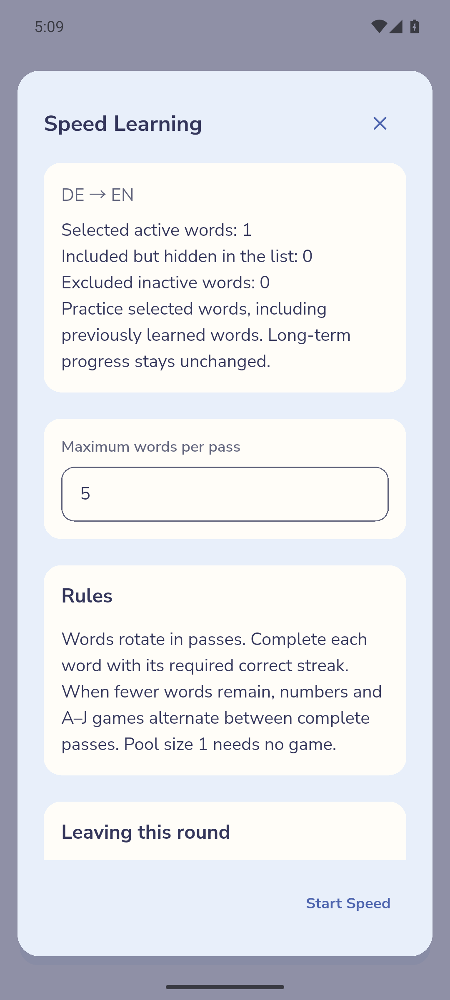

# Using Piko

Piko stores vocabulary on the device and offers self-assessed Long-term and Speed learning. This guide describes current implemented behavior. The [build manifest](build-manifest.json) identifies the current documented APK and its product captures. [Verification coverage](verification.md) distinguishes observed product flows from source and test evidence. The [gallery](screenshots.md) preserves the earlier documented build and its source identity; its control arrangements can predate the grouped Settings and editing surfaces described here.

## Contents

- [Collections](#collections)
- [Add vocabulary](#add-vocabulary)
- [Edit and delete vocabulary](#edit-vocabulary)
- [Examples, hints and activity](#optional-content)
- [Categories](#categories)
- [Search, filter, group and sort](#list-controls)
- [Temporary selection](#selection)
- [Long-term learning](#long-term)
- [Speed learning](#speed)
- [Statistics](#statistics)
- [JSON import and export](#transfer)
- [Settings](#settings)
- [Glossary](#glossary)

## Collections

From Home, choose **New** or **Create first collection**. Select the target language you are learning and the native language used for translations, choose a level from A1 to C2, enter a Collection name, then choose **Create collection**. The languages must differ and the name cannot be empty. Each language field opens a searchable directory with 128 choices: 120 base languages, six curated varieties and two Mandarin script options alongside generic Mandarin. Custom is available in the same picker. A custom name matching a catalog label in the current interface language after case/whitespace/punctuation normalization selects that catalog identity; otherwise the exact name is retained. Existing Collection languages and custom names remain fixed. Interface language is a separate setting.

Open a Collection from **My collections**. Its heading shows the language pair and vocabulary count. The information icon beside this metadata opens **How learning works**, including an expandable technical explanation. Closing help returns to the Collection.

Scrolling down keeps the Collection title, total entry count, Back/menu and separate compact Review and Speed actions available. Each action counts eligible word directions in the current search/filter scope, or the selected scope during selection mode; a word available in both directions counts twice. Zero stays visible and disabled; loading and errors remain distinct. One eligible direction starts directly (Speed still opens its setup); two directions offer a choice. Dismissing the choice/setup retains the list and selection. Return to the top to see the expanded direction cards and rename control. The compact header has no mascot. In an exceptionally short viewport, the header scrolls normally to keep content reachable.

Reading Piko appears beside the first available Review action, including when Speed is also available. Sleeping Piko accompanies the no-work message only when the current scope has no Review, new Speed words or pending repetition. Speed-only, empty, unmatched, loading and failed states show no contextual pose. These illustrations do not change learning data or indicate permanent mastery.

Use the heading's rename control to change its name; save or cancel that edit explicitly. The gear opens **Collection Settings**, also reachable through **App Settings → Collections**. This page groups the Collection level, learning preferences, category management, Trash, JSON import/export and a separate deletion action. The level defaults to A1 and can be changed here; it supplies the initial AI request level and does not measure mastery or reschedule vocabulary. Confirming deletion removes that Collection and its associated vocabulary/learning. Export anything you want to retain before deleting it; Collection deletion has no vocabulary-style Undo.

The app stores changes locally. There is no account, cloud synchronization or app-wide backup/restore flow in this build. Uninstalling the app or clearing its storage can remove local data. See [transfer](#transfer) for Collection JSON exchange and the separate all-Collection report.

Ordinary product emulator capture · [Full image](images/r10-collection.png) · [Capture metadata: `r10-collection`](build-manifest.json)

[Technical ownership](technical.md#runtime) · [Home and Collection images](screenshots.md#collections)

## Add vocabulary

1. Open a Collection and choose **+ New** in its Vocabulary area (accessible name **Add Entry**), then **Enter manually** in the Add vocabulary chooser. An empty Collection instead shows one **Add first word** action below its explanation. The chooser also offers **Import JSON** and, in an enabled private AI build, **Generate with AI**.
2. Enter a target word and its native translation in the new vocabulary card. Both are required.
3. Add optional content or categories as needed, then confirm with **Save & Next**. This creates a saved word and another draft for continuing entry.
4. Choose **Finish** to leave the session. If an unconfirmed draft remains, choose whether to continue editing or discard it. Already saved words remain saved.

The entry session retains previously confirmed words for revisiting and editing. A new draft is different from an existing saved card: completing both required fields alone does not confirm the new word. Once a word is saved, valid edits save automatically. Watch **Saving…**, **Saved** and validation/error feedback rather than assuming an invalid edit reached storage.

The same target/native pair can have separate entries with different Hints. Each meaning has its own UUID and starts with fresh learning. A complete pair plus Hint must be unique within its Collection: comparison normalizes Unicode, lowercases and collapses runs of Unicode whitespace, while preserving punctuation and accents. An absent or whitespace-only Hint is the same empty key. Change the pair or Hint to resolve a duplicate. Editing the Hint on an existing entry preserves its learning. Empty required fields and incomplete example pairs need correction before saving.

[Editor image](screenshots.md#editors) · [Identity and validation](technical.md#vocabulary)

## Edit and delete vocabulary

Open a word's edit control from the Collection vocabulary list. The edit dialog groups both words, optional examples/hint, categories and **Active**. Valid changes save automatically; Saving, Saved or unsaved status appears beside its heading. Close it when finished; pending writes drain before closing. Invalid raw text remains visible for correction and cannot be confirmed by closing. On a storage error, retain the editor and use **Retry** where offered.

You can also edit the current word after revealing an answer in normal, retry or Speed learning. Return from the editor to the same revealed answer before grading. Editing vocabulary does not itself count as an answer or reset its scheduling. Making the current word inactive removes it from eligible learning according to the current session's refreshed state.

Use **Reset learning progress** above Delete to choose one or both translation directions, then explicitly confirm. Reset creates fresh current Long-term progress, removes pending repetitions and clears Speed completion for those directions. Saved content, the other direction, past review events and statistics remain. Resetting the direction of an open learning round ends that captured round; reopen learning for the fresh state.

**Delete vocabulary** in a saved editor asks for confirmation. Cancel keeps the raw text and selection in that editor. Swipe deletion retains its separate explicit Delete action. Both paths move vocabulary to **Collection Settings → Trash**, where it remains recoverable for 24 hours from deletion. The immediate **Undo** window remains eight seconds.

Trash groups words by deletion operation. Expand a group to restore an individual word or its valid group members. Recovery retains identity, content, order, activity, complete directional learning and still-valid repetitions. Duplicate or identity conflicts remain in Trash and are reported; category definitions that no longer exist are omitted with an explanation. Recorded statistics are never added again by recovery. **Empty Trash** requires confirmation and permanently removes its retained recovery copies. Expired copies are purged when the app opens or accesses recovery; the retention period does not restart when reopening Trash. Collection deletion also removes that Collection's Trash and remains a separate irreversible operation.

[Editor image](screenshots.md#editors) · [Persistence and guarded writes](technical.md#storage)

## Examples, hints and activity

- **Add examples** opens example pairs, each containing the target-language sentence and native-language sentence. Complete both sides or leave the pair empty. Use **Add example pair** for another pair; removing a pair removes that optional content.
- **Hint** is directly visible in the editor. **Show hint automatically** controls whether it is visible during learning. When off, a hint can be revealed by tapping its control.
- In **Collection Settings**, a Collection can **Show hints automatically for new vocabulary**. This changes defaults for new words; existing words retain their own setting. An editor may offer to use a changed visibility choice for new words as well.
- **Active** includes a word in learning. Inactive words remain visible/editable in the Collection but are excluded from normal and Speed learning in both directions. Activity is independent of readiness and does not erase progress.

With no examples, the section shows **Add examples** without empty input fields. Existing pairs appear directly; Hint and Categories remain visible sections. Each example side permits up to 1,000 characters and a hint up to 2,000. Changing optional content preserves the word's learning identity. The app-wide **Show examples on questions** setting affects question-side examples; it does not delete saved examples or change the answer's stored content.

Detailed cards expose more saved content than Compact cards. During learning, content follows the question/answer language and hint visibility. A missing hint/example is simply absent, rather than a required field.

[Content rules](technical.md#vocabulary) · [Settings](#settings)

## Categories

New Collections start with four editable, removable groups: CEFR level (A1–C2), Topic (Food, Home, Time), Word type (Noun, Verb, Adjective, Fixed expression) and Source (Manually entered, AI-generated). Group/value names use the interface language at creation. Existing Collections are unchanged; removed or customized defaults are never recreated automatically. Manual entry confirmation adds the retained Manually entered label when available; imports and old entries are not assigned guessed acquisition labels.

Open **Collection Settings → Categories**. Choose **Add category group** for a dimension such as “Topic”, choose **One value** or **Multiple values**, then add its values. One value permits one assignment for each word; Multiple values permits several. Names and values belong to this Collection. Vocabulary tags share a soft background by category group. Colors are assigned automatically and remain stable through renaming and restarting; they are local presentation choices, excluded from JSON transfer. Open a category group to edit its grouped Properties and Values. Name, selection mode and carry-over commit together with **Save group**; leaving unsaved Properties asks whether to discard them. Value creation, rename and deletion are separate explicit actions.

Assign values from a vocabulary editor. Manage both group order and each group's Value order only in **Collection Settings → Categories**: drag the order control or choose **Move up / Move down** from its menu. The order saves immediately and applies to this Collection's pickers, tags, filters, category management and grouped headings. Initial starter Values are arranged alphabetically. Newly created groups and Values append after the existing order, including before any manual reordering. Renaming keeps the saved position. Filters stage membership only and have no reorder controls. Manage a dimension or value from the category page to rename or delete it. Deleting category metadata removes the relevant assignments rather than deleting vocabulary. Changing a Multiple dimension to Single can require resolving assignments; follow the app's conflict feedback instead of assuming a value was chosen for you.

Categories feed the list's filters and grouping. If none exist, the category/filter area explains that state; create category definitions before expecting values to select.

In category group Properties, each group has **Carry over from previous word**, initially off. Save the group to apply it. During manual entry, the next new draft copies that group's values from the last successfully confirmed word in the same session. You can change or clear them. Failed confirmations, browsing or editing older cards do not replace the next draft's values. A new session starts empty. The preference stays on this device and is not part of Collection JSON.

Ordinary product emulator capture · [Full image](images/r10-category-values.png) · [Capture metadata: `r10-category-values`](build-manifest.json)

[Category image](screenshots.md#categories) · [Category ownership](technical.md#queries)

## Search, filter, group and sort

The Collection vocabulary area has a search field and separate **Filters**, **Group** and **Sort** controls. These affect the displayed list without modifying the words.

Tapping outside search dismisses its keyboard. While a query is running, previous rows are hidden; a loading spinner appears if the query takes more than 150 ms. Only the latest query can display its results.

| Control | Use and result |
| --- | --- |
| Search | Match saved target/native text. Clear the query to recover words hidden by search. |
| Filters | Stage category selections, then **Apply**. Values within one dimension are alternatives; different dimensions must all match. **Clear filters** clears the pending filter selection. Dismissing without Apply keeps the applied filters. |
| Group | Choose one category dimension or **Ungrouped**, then Apply. Expand/collapse group headers individually or use **Expand all / Collapse all** beside the list's result count. View contains layout and language order. A word assigned to multiple values can appear in multiple groups. |
| Sort | Choose Original order, target/native A–Z or Z–A, or newest/oldest. Apply the choice. Older words without a recorded added date remain undated rather than receiving invented dates. |
| View | Change **Layout** between Compact and Detailed, and change **Language order** independently of the learning direction. |

View opens Layout and Language order as staged child dialogs: Back returns without applying, Apply saves and returns, and Close exits. Controls expose their current state and independent reset actions. Search and filters combine; changing Group or Sort does not clear them. An empty result is not deletion: clear search/filter restrictions to locate saved words again. View preferences are retained per Collection; temporary selection is separate. Compact uses flat side-by-side language rows, with full text available in the editor, and omits category tags, review dates and supplementary status. Detailed retains its richer content and learning status.

Collection Detail's learning launch availability uses the matching eligible vocabulary and configured direction, so filtering/searching can change the offered actions and counts. The Home review badge counts due word directions; completing one direction can leave the opposite direction due. A grouped duplicate is still one saved word.

[List image](screenshots.md#collections) · [Query and ordering details](technical.md#queries)

## Temporary selection

Hold a collapsed vocabulary card to start selection, then tap cards to toggle them. **Select all** includes the current search/filter matches, including words inside collapsed groups. A grouped word is selected once by identity even when displayed in several places. Each group heading also has a tri-state checkbox: it selects the current search/filter matches in that group, including collapsed children. A partially selected group becomes fully selected; selecting an already fully selected group clears only those members. Selection outside that group stays intact.

The vocabulary list uses the full viewport. A compact selection bar overlays its bottom only while words are selected; measured end spacing keeps the last card reachable. The count and actions share one line when they fit; otherwise the count occupies its own row above the actions. Controls wrap or scroll at large text sizes, with safe-area clearance at the bottom. With selection mode active at zero, its controls remain in the list without reserved overlay space.

Changing search/filter can hide selected words without deselecting them. The selection summary reports hidden selections. Use **Clear selection** to end selection explicitly; leaving the Collection also clears it.

Choose **Delete vocabulary** in the selection bar to delete the selected words, including hidden selections. Confirm the displayed count; cancelling keeps the selection. Grouped appearances refer to the same word and are deleted once. A successful deletion clears selection. Delete/Undo feedback appears above the bottom of the viewport rather than after the list. Each deleted word retains its eight-second Undo offer; restoring the latest offer reveals any earlier offer that is still valid.

While selection mode is active, use **Review** or **Speed** in the Collection header to learn the selected active words, including words hidden by later filters. Long-term includes only work eligible now; Speed also includes previously learned words. The selection counts words once; learning counts each eligible direction. A known-zero mode stays visible and disabled. Setup reports included, hidden, inactive and unavailable words. Cancel retains selection and scroll position; entering the round clears the temporary selection. Selection has no bulk edit or export operation and does not change Active/Inactive or saved filters.

Ordinary product emulator capture · [Full image](images/r10-selected-speed.png) · [Capture metadata: `r10-selected-speed`](build-manifest.json)

[Selection image](screenshots.md#selection) · [Selection ownership](technical.md#queries)

## Long-term learning

1. Open a Collection with active vocabulary due in the desired direction. Tap its directional review card (for example **FR → DE · 4 to review**); choose a direction when the app offers a choice.
2. Read the question and recall the answer. Tap the card to reveal it. Reveal a hidden hint if needed.
3. Choose **Incorrect** if you did not recall it, or **Correct** if you did. These are the two available ratings.
4. Continue through the available regular questions and repetitions. The progress display distinguishes completion from correct-on-first-try.

Correct schedules a later review; Incorrect creates an extra repetition obligation for this learning day. Previously recorded Hard ratings remain part of their original history and scheduling. Repetitions are separated by other graded questions where available. When none can fill the gap, the app can show a short countdown before the next repetition. A repeated answer does not create another normal scheduled-review event.

Before revealing a question, **Skip** defers it behind up to five other available questions, or toward the end when fewer remain. Skip gives no grade, learning credit or retry attempt and changes no stored scheduling; it does not dismiss a repetition obligation.

**Correct previous review** reveals the immediately previous answer again while its correction control is available. Choose Incorrect or Correct to replace that grade, then return to the retained pending work. This replaces its effect rather than adding an extra ordinary review. It is not a general learning-history editor.

**Total retries needed** counts actual accepted attempts beyond each item's first attempt in this open round. Skip and replacing a grade add no attempt. The counter appears during learning and in the completion summary; it is not a saved lifetime statistic.

When the captured work and repetitions are complete, the existing summary shows the completed counts and a decorative celebration Piko. Dismiss it to return to the Collection. **Exit review** leaves earlier saved answers intact. A save error keeps the operation unresolved; retry the grade instead of counting it as saved. **Nothing due right now** means the current scope has no eligible scheduled work, not that the vocabulary is mastered.

The Collection's information icon explains scheduling and repetitions. Readiness labels such as New, Retry pending, Due now and Next review are scheduling information. The build does not offer typed-answer assessment or automatic knowledge-level/mastery grading. Learning is independent for target → native and native → target.

[Learning image](screenshots.md#learning) · [Scheduler, retry and correction](technical.md#learning)

## Speed learning

Use a Collection's directional **Speed** action when eligible active words are available. The default pool comes from new words matching the current scope; active temporary selection replaces it with selected active words. Read the setup's word count, direction and rules. Set **Maximum words per pass** and choose **Start Speed**.

For selected practice, use the same Header Speed action while selection mode is active. A single preferred direction opens setup directly; when both directions are enabled, choose one. Start rechecks the whole selected set in the current Collection sort order, including hidden words. Inactive or deleted words are excluded. Changed counts remain visible for review before starting; failures retain setup and pool size for retry. No eligible words means no start. Previously reviewed or Speed-completed words remain eligible for this explicit practice.

Reveal each answer and choose Correct or Incorrect. A word finishes after a consecutive correct streak: one correct with no errors, two after one error, three after two, and four after three or more. An error resets that word's streak. Completed words leave the pool; waiting words enter as space becomes available. Short ordering games alternate between 1–10 and A–J at eligible breaks, starting with numbers in each session. There is no timer or score; touch and keyboard use the same shuffled positions. The session ends without an extra game once all work is complete. **Correct previous review** is also available during a game until the next vocabulary answer: reveal the last answered word, choose its replacement rating, and return to the retained work. After the round ends, correction is unavailable. A failed correction leaves the recoverable state visible.

Speed completion persists word-by-word. Completing a word preserves Long-term scheduling, history and pending repetitions in both directions, including after errors. Each completed word direction contributes at most once to that learning day's Speed statistics. Leaving before a word completes does not count that unfinished word as complete. In-memory pool/streak state is not a resumable saved session.

After every word has successfully saved its completion, Speed returns to the Collection with its completed-word message and one celebration Piko, temporarily replacing the contextual pose. In the compact header, the completion text and X remain visible without artwork. Dismiss the message with X; it also clears when another learning launch starts or when leaving the Collection. Exit, initially empty work, failed saves and exhaustion caused only by deactivation do not celebrate. The notice includes **Total retries needed** for that round, counting accepted attempts beyond each word's first, including required consecutive practice. Grade replacement adds no attempt. No timer is added.

[Speed images](screenshots.md#speed) · [Speed state and persistence](technical.md#speed)

## Statistics

Home shows **Activity** above Collections. Open its card for **Statistics**, with Long-term selected initially and a separate Speed view. Activity remains accessible after deleting all Collections if recorded learning remains. A new installation with no Collections or activity keeps the ordinary empty Home.

**Vocabulary learned** counts successfully saved regular Long-term answers, including repeated words and both directions. It does not measure distinct words or mastery. Grade correction keeps the original credit; retry answers do not add another regular answer. The streak counts consecutive learning days with at least one regular answer. With no answer today, yesterday's streak remains open and a reminder appears. The average uses positive-count active days within the last 30 learning days, including today; it is absent when there are none.

Daily activity starts with seven recent days. **Show calendar** opens a Monday-first month calendar; browse previous months or choose a month and year. Future months are unavailable. A dash means unrecorded history, zero means a recorded idle day, and an asterisk marks partial coverage. **Statistics recorded since** identifies the start; earlier activity is not reconstructed from old or imported learning.

A learning day changes at local **04:00**. Saved activity retains its assigned date through later timezone changes. A backwards clock change temporarily hides future-dated activity. Statistics refresh after learning, opening, resuming, system clock changes and the day boundary. Loading and errors have explicit status; a failed refresh labels retained values as potentially out of date and offers retry.

Speed shows today's successful word-direction completions, counted once per word, direction and learning day. Repeated completion can count on another day. Unfinished words contribute nothing; completed words keep their credit when a session is abandoned. Speed does not change the Long-term average or streak. Deleting vocabulary or Collections does not delete already recorded statistics.

## JSON import and export

Open the Collection gear → **Collection Settings → Data → JSON import / export** in the destination/source Collection. **New → Import** is an alternate entrance to the same Collection-scoped import. The Import and Export tabs operate on that one Collection.

### Export a Collection

On the Export tab, use **Copy JSON** or **Save JSON file** to generate and keep the current Collection export. The Android file picker owns the chosen destination and overwrite consent. If saving fails, a copyable JSON fallback is shown.

Export includes vocabulary, categories, optional content, activity and associated directional learning. It is not an app-wide backup. In particular, importing this export does not restore learning progress; keep that distinction in mind before deleting anything or moving devices.

### Export all Collections and statistics

From global **Settings**, choose **Export all Collections**. Choose a destination in Android's save dialog for `piko-full-export.json`. The file includes every Collection and the complete recorded daily statistics, including counts retained after Collection deletion. It uses a consistent snapshot; global settings and unfinished drafts are excluded.

This is a report, not a restore file: the Collection importer rejects it. Saving can be retried after an error; canceling the system dialog does not report success or change local data. The existing single-Collection export remains separate and contains no statistics.

### Check and apply an import

1. Use **Choose JSON file**, **Paste from clipboard**, or edit **Paste or edit JSON**. **Copy example JSON** supplies synthetic structure for the Collection's language pair.
2. Choose **Check JSON**. Review the new/updated/unchanged/error counts and row/path errors. Checking alone saves nothing.
3. Choose which content groups to import: target text, native text, category assignments, examples, hint and Activity. Recheck after changing groups.
4. Fix errors and check again. When valid, choose **Import vocabulary** and confirm the batch.

Files must be valid UTF-8 JSON within 1,000,000 bytes, use the Piko vocabulary format, contain exactly one Collection and match the destination language pair. Only current schema version 5 is accepted. Both language fields contain explicit catalog/custom identity objects; custom names match across installations after the same bounded normalization, while destination labels remain unchanged. See [manual conversion examples](json-format.md) for older files. Existing IDs update selected content; absent selected groups leave existing content unchanged. New vocabulary requires both words. Conflicting identities, invalid categories or duplicate final word-pair/Hint tuples block the batch. The check uses effective content after selected groups, omissions and clears are resolved.

Existing learning is preserved. Imported learning and statistics data are ignored; new entries receive fresh learning state. When Activity is absent or unselected, existing words keep their activity and new words are Active. Imported Collection identity/name does not rename or replace the destination Collection. A stale preview after another change requires **Check JSON** again. Failed apply saves no partial batch.

[Import/export images](screenshots.md#transfer) · [Format and compatibility](technical.md#interchange)

## Settings

From Home, open the Settings gear. **General** contains App language, **Learning** contains direction and question examples, **Data** contains full export, and **Areas → Collections** opens the overview of Collection-specific Settings. Choose **App language** → English or Deutsch; this retained preference is separate from each Collection's vocabulary languages. The same Collection Settings page is available from its own gear and groups the Collection level, Hint default, categories, Trash, import/export and deletion.

**Learning direction** selects Target → Native, Native → Target, or Both directions separately. It affects eligible launch choices; it does not merge the two directions' progress. **Show examples on questions** changes question-side presentation while preserving stored examples.

Settings report loading/saving failures. If a preference cannot be saved, the app restores its previous choice and offers retry. Return using Back. Account/sync controls and a developer-settings interface are not available.

[Settings image](screenshots.md#settings) · [Preference ownership](technical.md#runtime)

## Optional AI vocabulary

AI is hidden in ordinary builds. An explicitly enabled private-test build can propose topic/level vocabulary, inventory gaps, related Hints and saved-Collection corrections. Access must also be configured and approved by the service. Manual editing and learning remain available without it.

When valid access or consent is missing, AI opens its access-and-privacy dialog. Existing valid consent does not require repeating it on every visit; **AI access and privacy** remains available. Choose topic generation, **Build vocabulary from A1 to target level**, inventory gaps or Collection review. Choose a level, initially the Collection's level, and optional learning goals. Topic text appears for topic generation only.

Collection review starts with all six checks enabled: translations/spelling, examples, Hints, suitability, structure/consistency and categories. Choose the checks to request. Category review offers **Fill missing**, which preserves existing assignments, **Review and improve**, or **Reclassify all**. Review's own Filters starts unfiltered on each visit and includes matching active and inactive words in its count without listing them. Its staged category choices are independent of the vocabulary list's filters; applying or clearing them does not change that list. New category groups and Values have separate proposal permissions.

Preview the target/native meanings, optional Hints, bilingual examples and category changes; select each proposal you want. New category definitions need separate selection. Nothing is selected or saved automatically. Saved Source labels and learning state remain protected. A new meaning receives a fresh card rather than reusing another meaning's progress.

A1-to-target generation starts at A1. Resolve each portion by explicitly adopting chosen vocabulary or discarding it before requesting another portion or advancing to the next level. No portion or level certifies complete coverage. An incomplete generation can request another portion, which may incur costs. Earlier proposals remain visible and count toward the shared technical capacity. You can instead explicitly accept a partial result; its quantity does not certify complete topic or level coverage. Changing the underlying inventory invalidates the preview. Oversized context offers an explicit smaller-step request with its limited scope shown. Resolve the current context portion before explicitly requesting the next; the remaining inventory keeps its original membership as changes are adopted. These context portions are separate from requesting more generated vocabulary. The app never silently drops words or retries a paid request. Errors distinguish context size, network, access, quota/rate, timeout, invalid response and service availability while preserving inputs and usable choices. Stopping a follow-up keeps the previous usable result and selections; an already submitted request may still incur costs.

Use **Regenerate original task** to request a fresh answer, or enter a follow-up such as more/fewer words, a different focus or spelling corrections. The original result stays available while the replacement is generated. Review the replacement and choose **Use this preview** or **Keep previous result**. Using a replacement clears all proposal selections; it never edits saved vocabulary automatically. Every admitted follow-up may incur costs.

Related Hints compare direct same-target or same-native meanings, including inactive cards. Selecting fewer target cards retains the full direct comparison group. For a new draft, approved Hints stay staged until Add-next or Done successfully saves that draft and the selected related changes together. Cancel or a failed save applies none of them. A saved card's normal edits finish before the Hint request.

Content is sent only for the requested Collection scope. Learning history, statistics and other Collections are excluded. The device stores its optional backend session encrypted with Android Keystore; no provider key is present in the app. The private test requires an invitation, a current notice and explicit server-recorded consent. Its notice identifies the contact, processors, expiry and shared request limits. Submitted requests/results, follow-ups, adoption selections and optional feedback are stored privately for quality analysis under the notice’s bounded retention. No tester can read another tester’s content. **Stop participation and request payload deletion** stops new use and removes live analysis payloads; a failed network attempt remains visibly unconfirmed and AI stays blocked locally across restart. The retained encrypted session can only retry withdrawal. Manual vocabulary and learning remain usable. OpenAI temporarily retains asynchronous responses for about ten minutes and standard provider processing applies. A valid result format does not establish linguistic correctness; check meanings, examples and actual coverage before adopting proposals.

## Glossary

| Term | Meaning in this app |
| --- | --- |
| Collection | Named vocabulary container with one target/native language pair. |
| Collection level | Retained A1–C2 choice used as an initial AI request level; not measured mastery. |
| Target / Native | The learned language and translation language; not the interface locale. |
| Word / vocabulary entry | One saved target/native pair with a stable identity and optional content. |
| Example pair | Target and native example sentences attached to a word. |
| Hint | Optional text with per-word automatic/reveal visibility. |
| Category dimension / value | A Collection-owned classification and one of its selectable labels. |
| Active / Inactive | Inclusion/exclusion from learning, independent of readiness. |
| Direction | Target → Native or Native → Target, each with independent learning state. |
| Due / Retry pending | Scheduled availability or an outstanding same-day repetition, not mastery. |
| Long-term | Scheduled self-assessment using persisted direction-specific progress. |
| Speed | Pool-based consecutive-correct practice with completion effects per direction. |
| Total retries needed | Accepted attempts after each item's first in the current round; not a lifetime statistic. |
| Trash | Local vocabulary recovery copies retained for 24 hours after deletion. |
