# Product screenshots

Real captures of the ordinary APK selected in the [build/capture manifest](build-manifest.json), opened through its normal entry point on an Android emulator with synthetic content. This is emulator observation, not physical-phone acceptance. Images are full unmodified captures including system UI; some named states are intentionally scrolled. No test harness, mockup or generated image is used.

The manifest owns exact version/build, original source, APK checksum and per-image capture metadata. Each caption names its stable capture ID. [Verification coverage](verification.md) records limits. Click **Full image** if reduced labels are difficult to read.

- [Collections](#collections)
- [Vocabulary editors](#editors)
- [Categories](#categories)
- [Selection](#selection)
- [Long-term learning](#learning)
- [Speed learning](#speed)
- [JSON transfer](#transfer)
- [Settings](#settings)

## Collections

### Empty Home

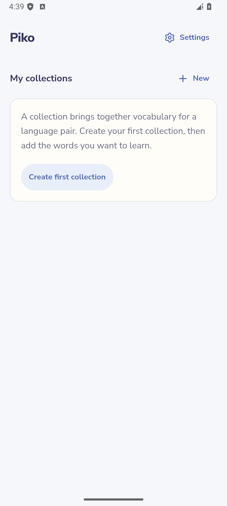

Ordinary product emulator capture · EN · [Full image](images/01-empty-home.png) · [Metadata: `01-empty-home`](build-manifest.json) · [Related task](features.md#collections)

### New Collection dialog with default Korean/German pair

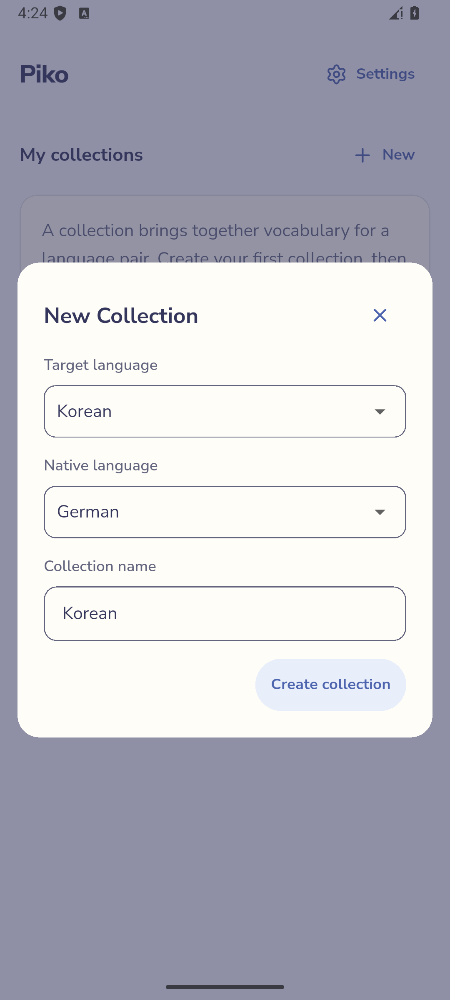

Ordinary product emulator capture · EN · [Full image](images/02-create-collection.png) · [Metadata: `02-create-collection`](build-manifest.json) · [Related task](features.md#collections)

### Four-word Collection before learning; list top

Ordinary product emulator capture · EN · [Full image](images/06-collection-list.png) · [Metadata: `06-collection-list`](build-manifest.json) · [Related task](features.md#collections)

### Topic grouping with four collapsed groups; page slightly scrolled

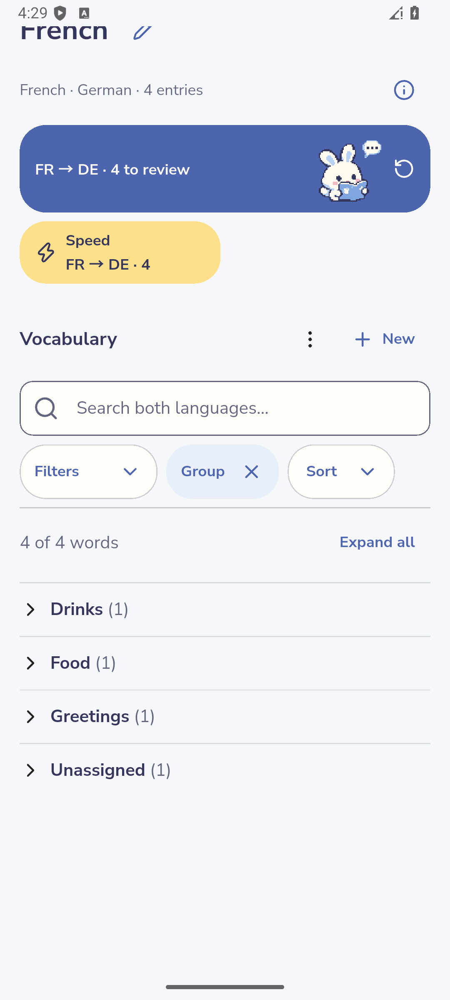

Ordinary product emulator capture · EN · [Full image](images/08-grouped-list.png) · [Metadata: `08-grouped-list`](build-manifest.json) · [Related task](features.md#list-controls)

## Vocabulary editors

### Unconfirmed French/German word draft

Ordinary product emulator capture · EN · [Full image](images/03-entry-draft.png) · [Metadata: `03-entry-draft`](build-manifest.json) · [Related task](features.md#add-vocabulary)

### Entry draft scrolled to example pair and hidden hint

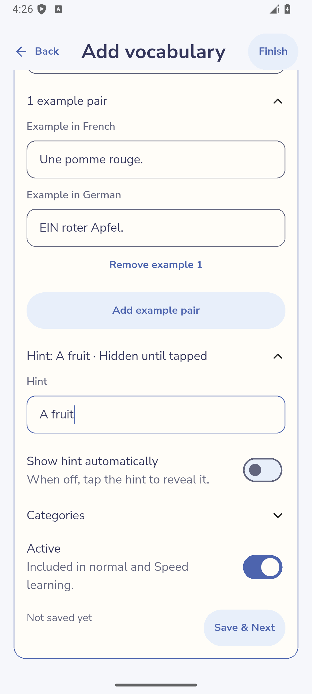

Ordinary product emulator capture · EN · [Full image](images/04-optional-content.png) · [Metadata: `04-optional-content`](build-manifest.json) · [Related task](features.md#optional-content)

### Collection list scrolled to the saved bonjour editor

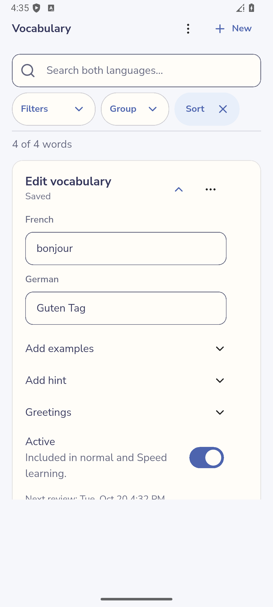

Ordinary product emulator capture · EN · [Full image](images/22-saved-editor.png) · [Metadata: `22-saved-editor`](build-manifest.json) · [Related task](features.md#edit-vocabulary)

### Inline editor open within the same revealed regular answer

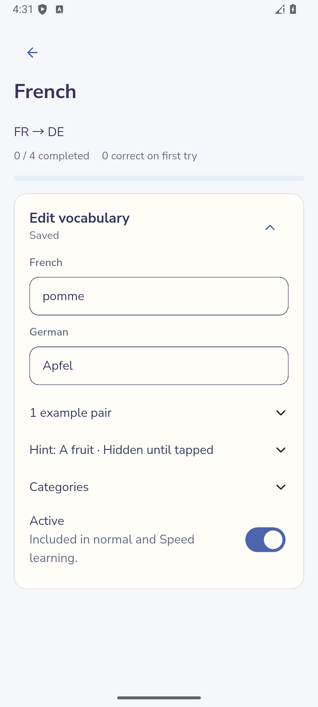

Ordinary product emulator capture · EN · [Full image](images/15-answer-editor.png) · [Metadata: `15-answer-editor`](build-manifest.json) · [Related task](features.md#edit-vocabulary)

### Collection More options with Settings expanded

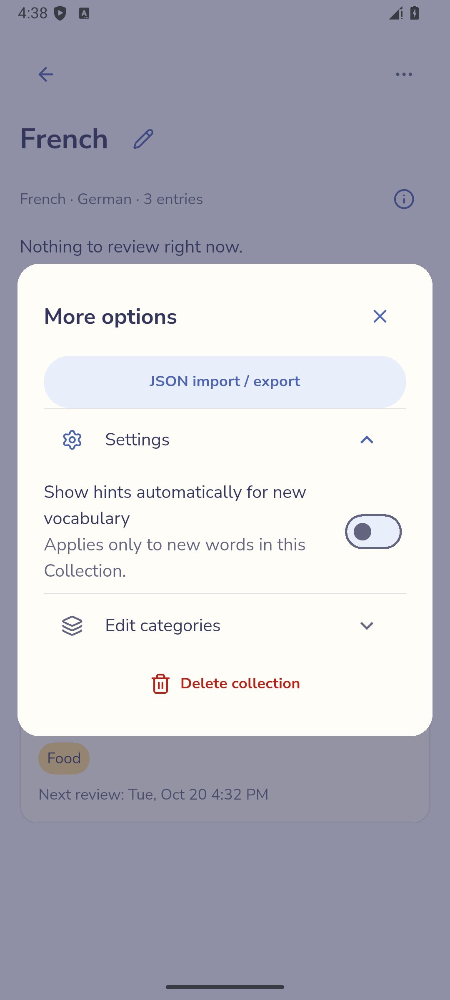

Ordinary product emulator capture · EN · [Full image](images/23-collection-settings.png) · [Metadata: `23-collection-settings`](build-manifest.json) · [Related task](features.md#optional-content)

## Categories

### Expanded Topic dimension in More options

Ordinary product emulator capture · EN · [Full image](images/07-categories.png) · [Metadata: `07-categories`](build-manifest.json) · [Related task](features.md#categories)

## Selection

### All four selected; Food filter leaves three selected words hidden

Ordinary product emulator capture · EN · [Full image](images/10-hidden-selection.png) · [Metadata: `10-hidden-selection`](build-manifest.json) · [Related task](features.md#selection)

## Long-term learning

### How learning works dialog at the main explanation

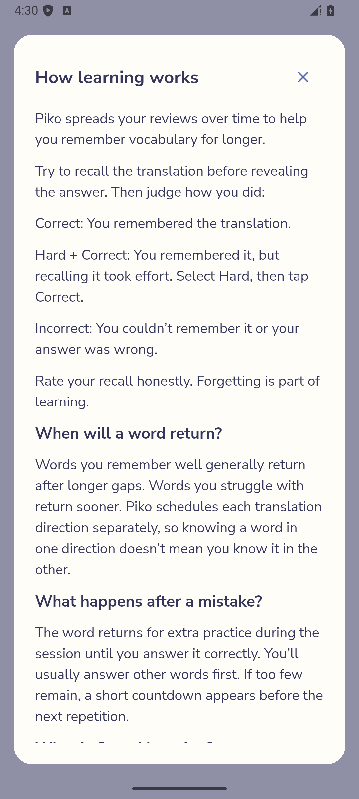

Ordinary product emulator capture · EN · [Full image](images/11-learning-help.png) · [Metadata: `11-learning-help`](build-manifest.json) · [Related task](features.md#long-term)

### First revealed regular answer; no grades yet

Ordinary product emulator capture · EN · [Full image](images/14-long-term-answer.png) · [Metadata: `14-long-term-answer`](build-manifest.json) · [Related task](features.md#long-term)

### Replacing the immediately previous Incorrect grade

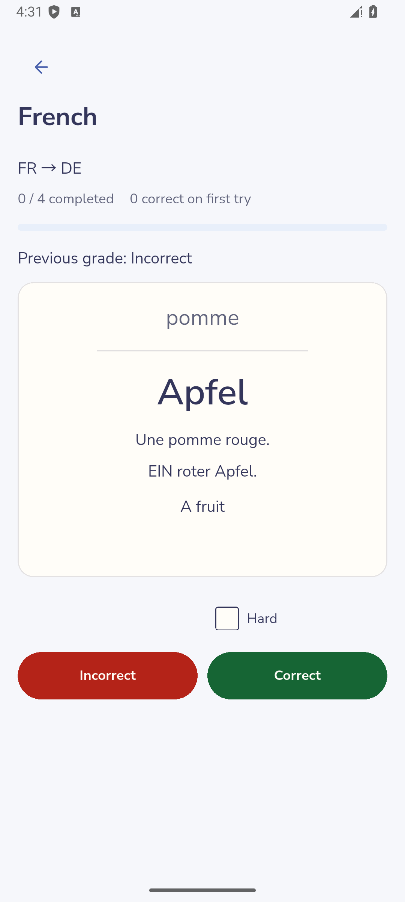

Ordinary product emulator capture · EN · [Full image](images/16-grade-correction.png) · [Metadata: `16-grade-correction`](build-manifest.json) · [Related task](features.md#long-term)

### Three words complete; countdown before the remaining repetition

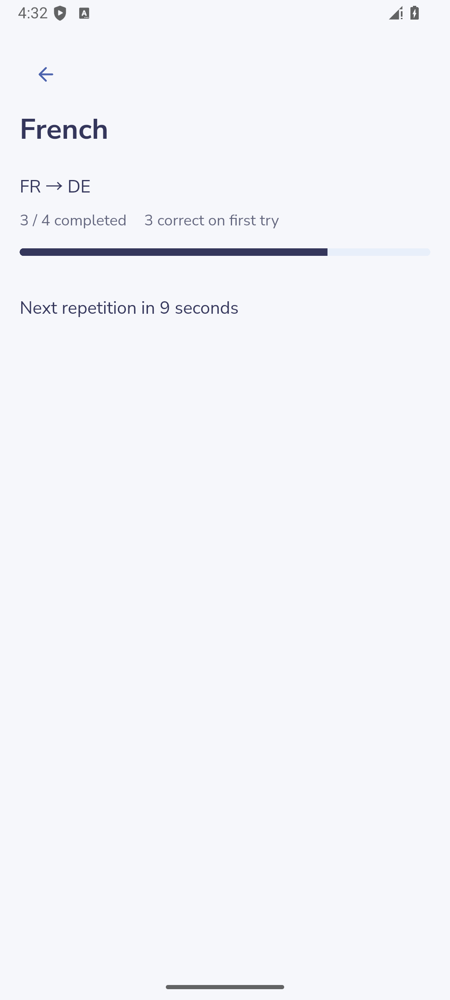

Ordinary product emulator capture · EN · [Full image](images/17-retry-state.png) · [Metadata: `17-retry-state`](build-manifest.json) · [Related task](features.md#long-term)

### Four completed, three correct on first try

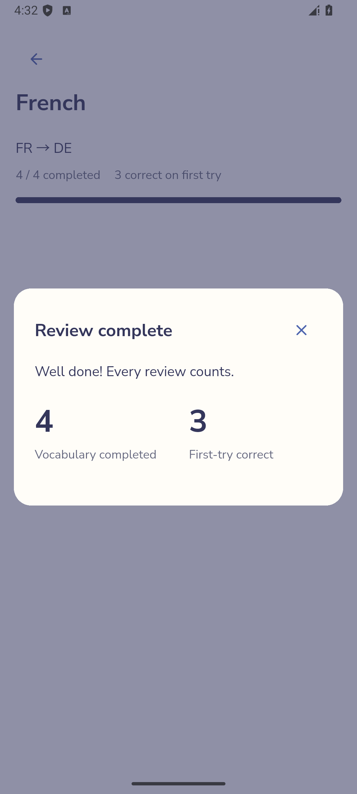

Ordinary product emulator capture · EN · [Full image](images/18-review-summary.png) · [Metadata: `18-review-summary`](build-manifest.json) · [Related task](features.md#long-term)

## Speed learning

### Four eligible new words; maximum five words per pass

Ordinary product emulator capture · EN · [Full image](images/12-speed-setup.png) · [Metadata: `12-speed-setup`](build-manifest.json) · [Related task](features.md#speed)

### Revealed Speed answer before first completion

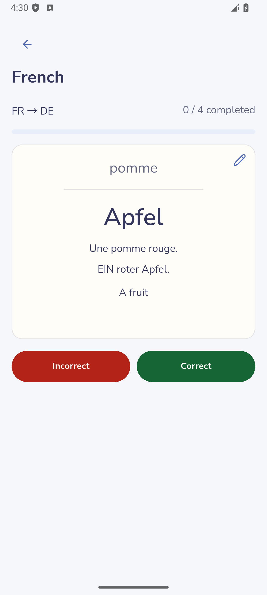

Ordinary product emulator capture · EN · [Full image](images/13-speed-answer.png) · [Metadata: `13-speed-answer`](build-manifest.json) · [Related task](features.md#speed)

## JSON transfer

### Import scrolled to selected groups and zero-error preview

Ordinary product emulator capture · EN · [Full image](images/05-import-preview.png) · [Metadata: `05-import-preview`](build-manifest.json) · [Related task](features.md#transfer)

### Native save completed; Export tab success

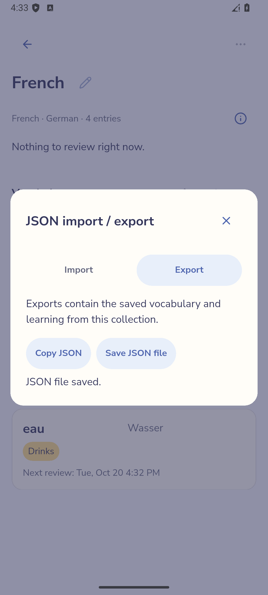

Ordinary product emulator capture · EN · [Full image](images/19-export.png) · [Metadata: `19-export`](build-manifest.json) · [Related task](features.md#transfer)

## Settings

### App-wide preferences in English

Ordinary product emulator capture · EN · [Full image](images/20-settings.png) · [Metadata: `20-settings`](build-manifest.json) · [Related task](features.md#settings)

### App-wide preferences after switching to Deutsch

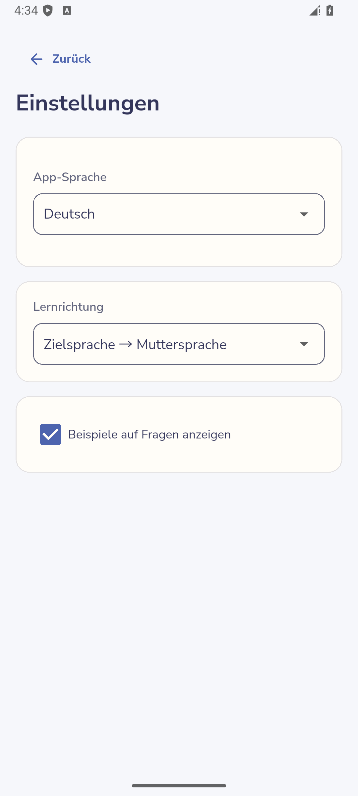

Ordinary product emulator capture · DE · [Full image](images/21-settings-de.png) · [Metadata: `21-settings-de`](build-manifest.json) · [Related task](features.md#settings)
