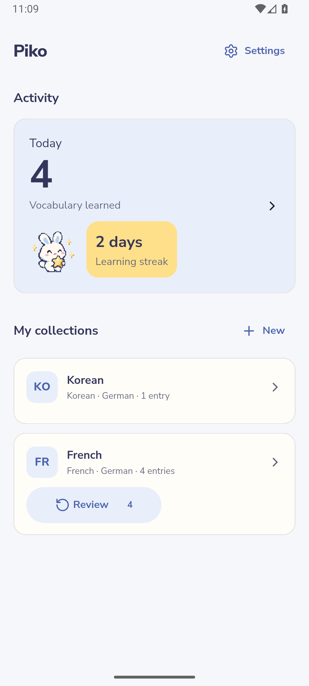
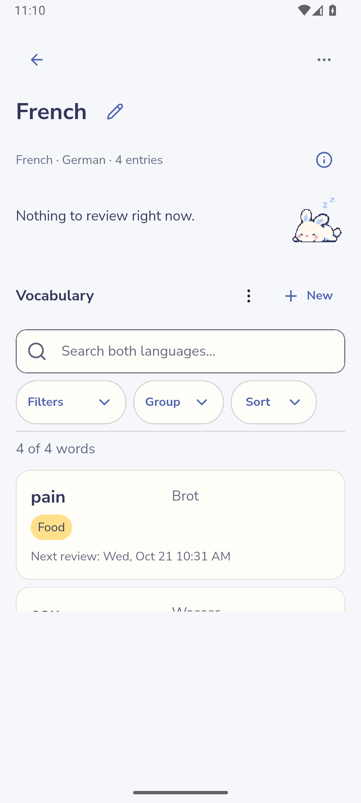
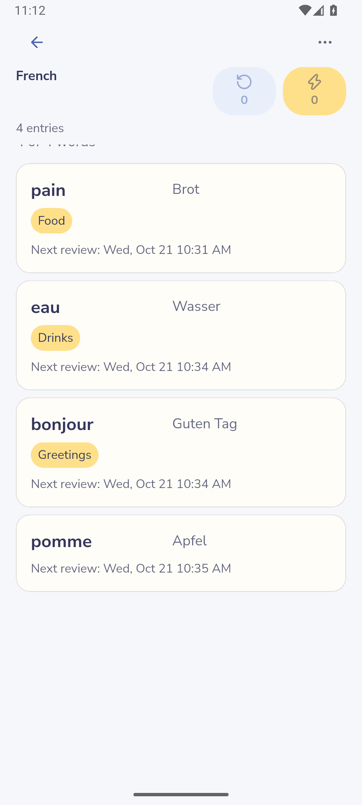
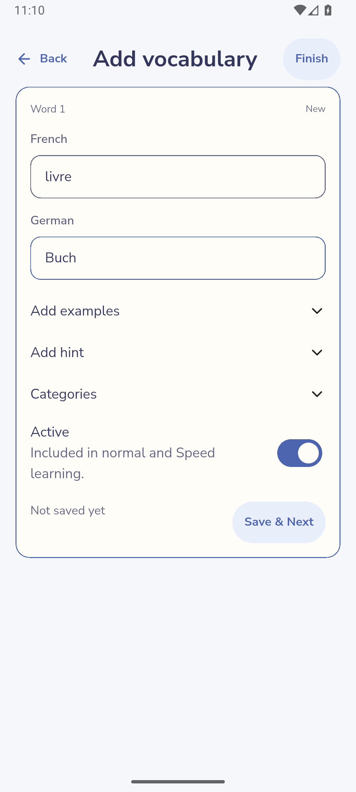
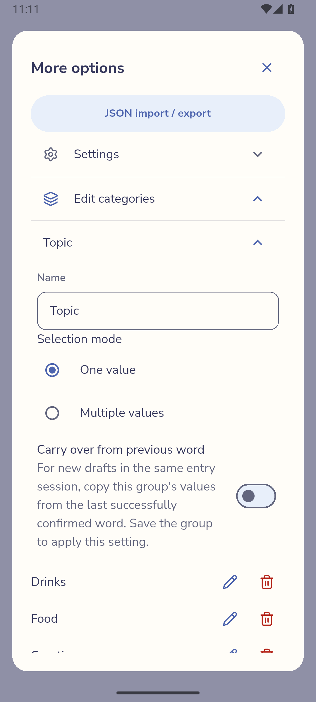
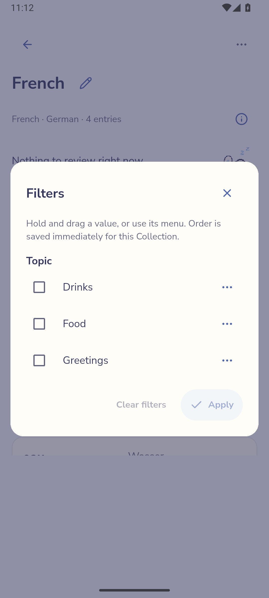
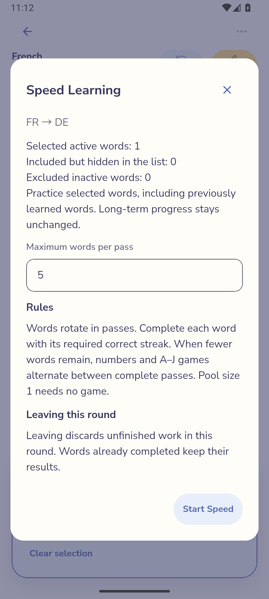
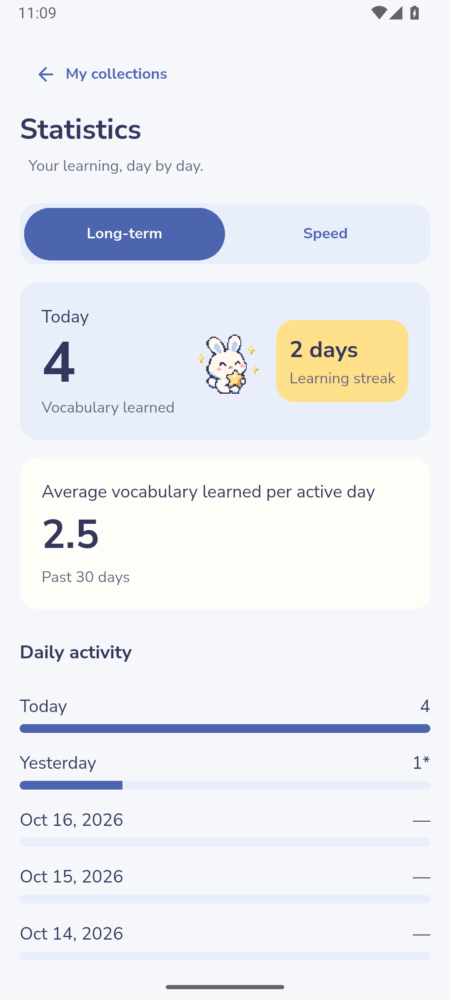
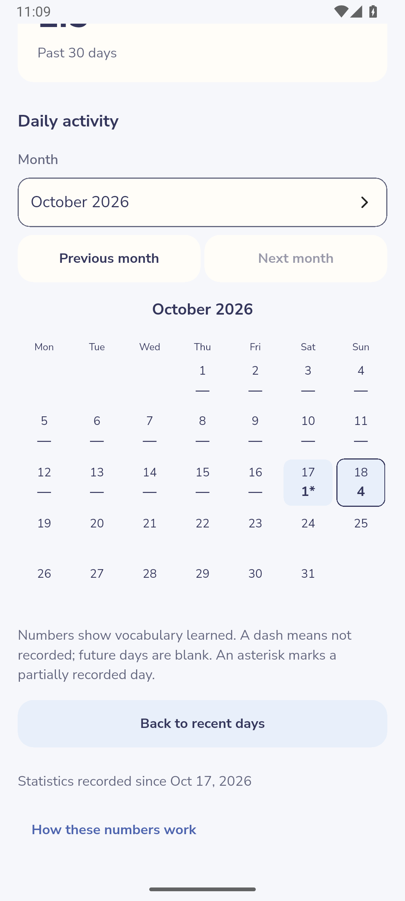
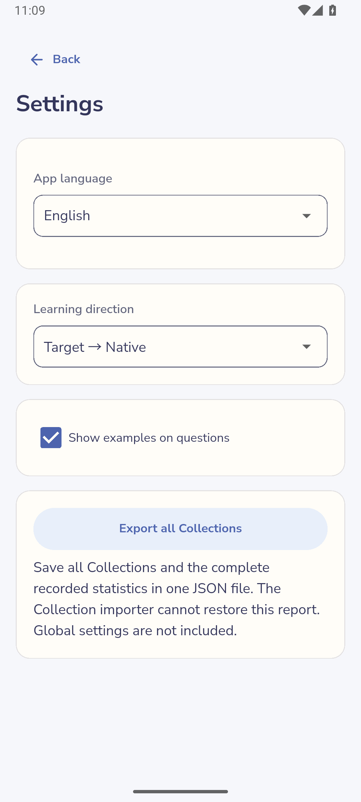

# Product screenshots

Original full captures of the normal APK identified in the [build manifest](build-manifest.json), including system UI. English, normal text size, Android emulator and retained synthetic data. Captures are sometimes intentionally scrolled. Unsaved editor input is discarded. These are ordinary-product observations; [verification coverage](verification.md) separates instrumented evidence and physical-phone gaps.

- [Collections](#collections)
- [Vocabulary editors](#editors)
- [Categories](#categories)
- [Selection](#selection)
- [Long-term learning](#learning)
- [Speed learning](#speed)
- [Statistics](#statistics)
- [JSON transfer](#transfer)
- [Settings](#settings)

## Collections

### Home Activity with retained four-word French Collection and recorded learning

[Full image](images/r7-home.png) · [Metadata](build-manifest.json) · [Related task](features.md#statistics)

### French Collection with four retained words and no currently due review

[Full image](images/r7-collection.png) · [Metadata](build-manifest.json) · [Related task](features.md#collections)

### Compact French header with total and separate zero-availability Review and Speed controls

[Full image](images/r7-compact-header.png) · [Metadata](build-manifest.json) · [Related task](features.md#collections)

## Vocabulary editors

### Unsaved manually typed livre and Buch with manual examples and Hint controls

[Full image](images/r7-entry-draft.png) · [Metadata](build-manifest.json) · [Related task](features.md#add-vocabulary)

## Categories

### Category group editor with default-off session carry-over and explicit-save explanation

[Full image](images/r7-categories.png) · [Metadata](build-manifest.json) · [Related task](features.md#categories)

### Category Filters with permanent ordering independent of Apply

[Full image](images/r7-filters.png) · [Metadata](build-manifest.json) · [Related task](features.md#categories)

## Selection

### Selected Speed setup for one reviewed word, with fixed direction and hidden and inactive counts

[Full image](images/r7-selected-speed.png) · [Metadata](build-manifest.json) · [Related task](features.md#selection)

## Long-term learning

See the [feature guide](features.md#long-term) and source-bound [verification coverage](verification.md). No fresh gallery image is claimed for this flow.

## Speed learning

See the [feature guide](features.md#speed) and source-bound [verification coverage](verification.md). No fresh gallery image is claimed for this flow.

## Statistics

### Long-term Statistics with recorded activity and partial coverage

[Full image](images/r7-statistics.png) · [Metadata](build-manifest.json) · [Related task](features.md#statistics)

### Monday-first October learning calendar with partial coverage marker

[Full image](images/r7-calendar.png) · [Metadata](build-manifest.json) · [Related task](features.md#statistics)

## JSON transfer

See the [feature guide](features.md#transfer) and source-bound [verification coverage](verification.md). No fresh gallery image is claimed for this flow.

## Settings

### Global Settings with four cards, immediate preferences and full export

[Full image](images/r7-settings.png) · [Metadata](build-manifest.json) · [Related task](features.md#settings)
