# Product screenshots

Original full captures of ordinary build **16**, identified by the [build manifest](build-manifest.json), including system UI. All use English, normal text size and an Android API-36 emulator with synthetic English/German content. Captures span October 22–23, 2026; Home and list states precede the later learning session. The editor, category Properties/Values and Speed setup are intentionally scrolled. No crop, redaction or UI reconstruction is applied. [Verification coverage](verification.md) separates these observations from synthetic test results and device gaps.

- [Collections](#collections)
- [Vocabulary editors and recovery](#editors)
- [Categories](#categories)
- [Selection](#selection)
- [Long-term learning](#learning)
- [Speed learning](#speed)
- [Statistics](#statistics)
- [JSON transfer](#transfer)
- [Settings](#settings)

## Collections

### Home Activity before learning, with one synthetic three-word English/German Collection

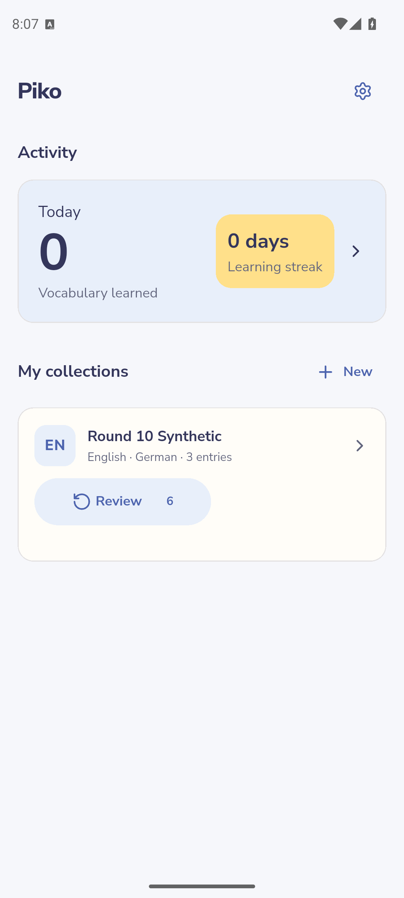

[Full image](images/r10-home.png) · [Metadata: `r10-home`](build-manifest.json) · [Related task](features.md#statistics)

### Collection with flat Compact bilingual rows and separate Review and Speed actions

[Full image](images/r10-collection.png) · [Metadata: `r10-collection`](build-manifest.json) · [Related task](features.md#collections)

## Vocabulary editors and recovery

### Scrolled saved vocabulary editor with heading save status, Active, Reset and Delete controls

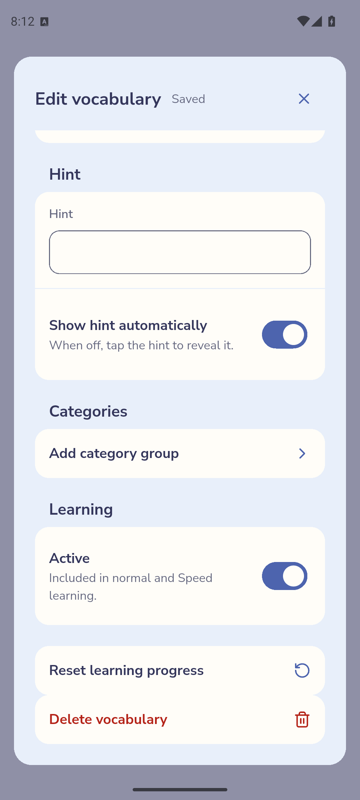

[Full image](images/r10-editor.png) · [Metadata: `r10-editor`](build-manifest.json) · [Related task](features.md#edit-vocabulary)

### Delete confirmation over the saved editor, explaining that vocabulary moves to Trash

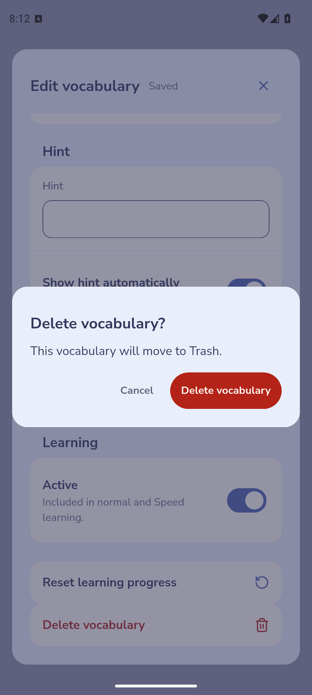

[Full image](images/r10-delete-confirm.png) · [Metadata: `r10-delete-confirm`](build-manifest.json) · [Related task](features.md#edit-vocabulary)

### Learning-reset confirmation with both directions selected and statistics-preservation explanation

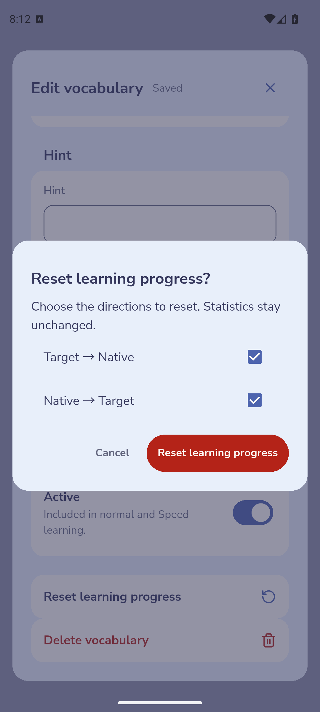

[Full image](images/r10-reset-confirm.png) · [Metadata: `r10-reset-confirm`](build-manifest.json) · [Related task](features.md#edit-vocabulary)

### Expanded Trash operation with individual Restore, Restore group and Empty Trash controls

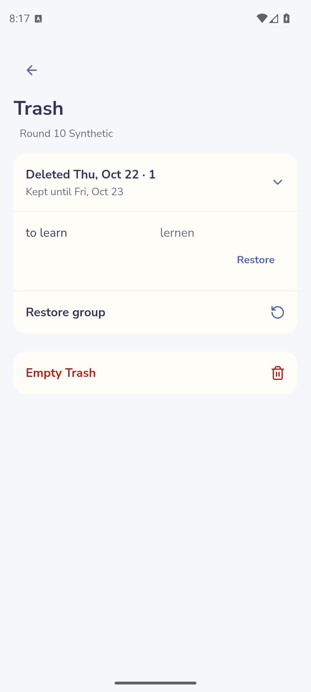

[Full image](images/r10-trash.png) · [Metadata: `r10-trash`](build-manifest.json) · [Related task](features.md#edit-vocabulary)

## Categories

### Scrolled Practice category group with appended Values Zulu then Alpha and ordering menus

[Full image](images/r10-category-values.png) · [Metadata: `r10-category-values`](build-manifest.json) · [Related task](features.md#categories)

## Selection

### One selected Compact row with selection count, Select all, Clear selection and Delete vocabulary

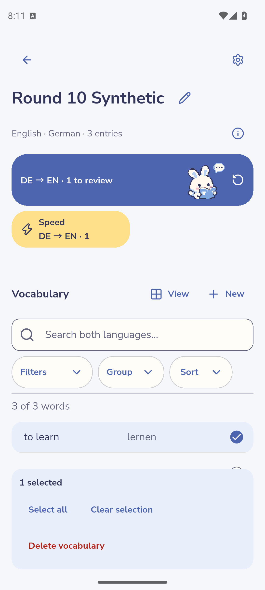

[Full image](images/r10-selection.png) · [Metadata: `r10-selection`](build-manifest.json) · [Related task](features.md#selection)

## Long-term learning

### Long-term German-to-English question with progress, total retries and Skip

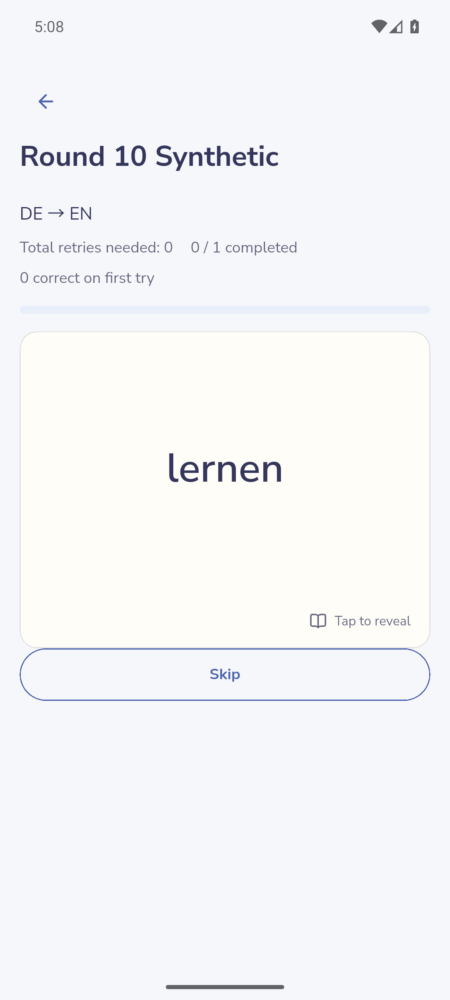

[Full image](images/r10-learning.png) · [Metadata: `r10-learning`](build-manifest.json) · [Related task](features.md#long-term)

### Review completion showing one completed word, one first-try correct answer and zero retries

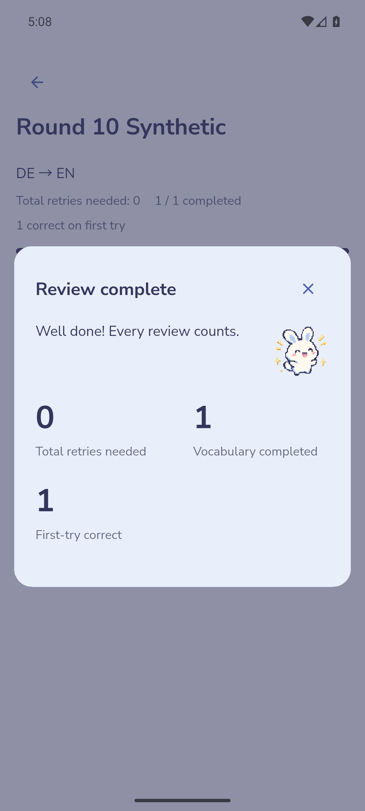

[Full image](images/r10-review-summary.png) · [Metadata: `r10-review-summary`](build-manifest.json) · [Related task](features.md#long-term)

## Speed learning

### Selected Speed setup for one active reviewed word with hidden and inactive counts

[Full image](images/r10-selected-speed.png) · [Metadata: `r10-selected-speed`](build-manifest.json) · [Related task](features.md#selection)

### German-to-English Speed question with progress and total retries

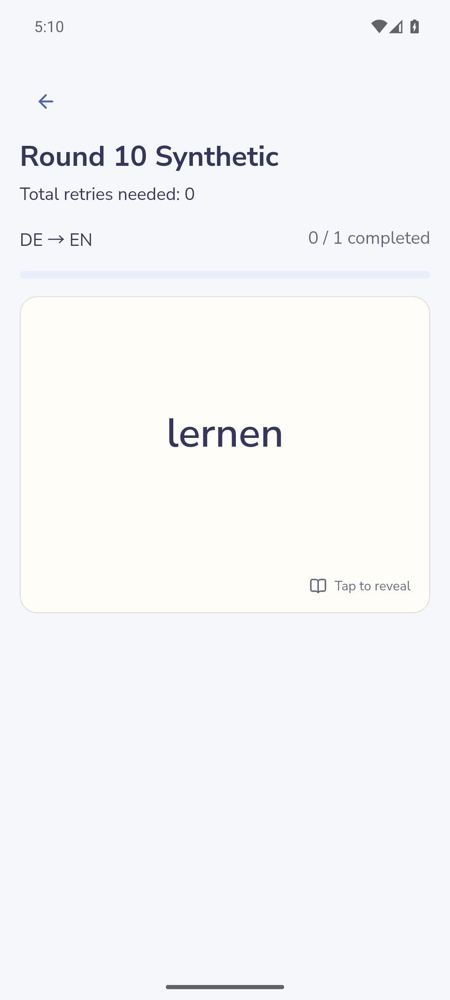

[Full image](images/r10-speed.png) · [Metadata: `r10-speed`](build-manifest.json) · [Related task](features.md#speed)

### Collection Speed-completion notice showing one completed word and zero retries

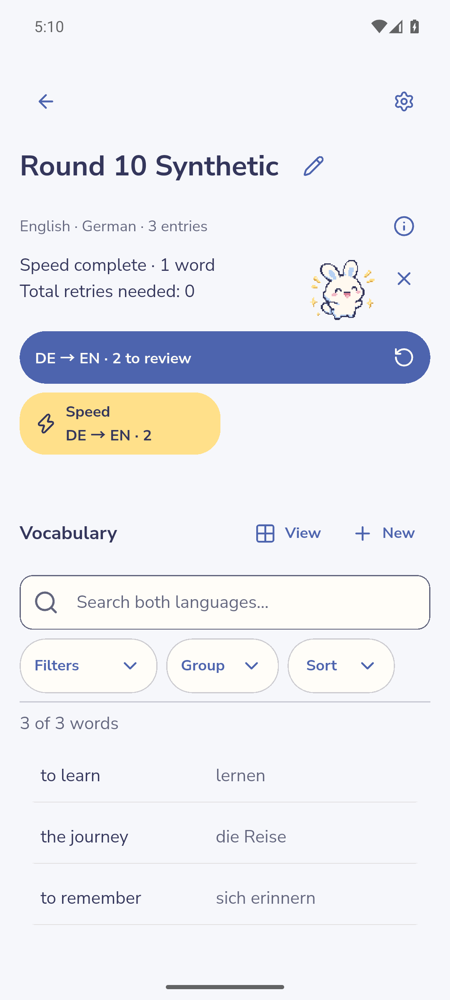

[Full image](images/r10-speed-summary.png) · [Metadata: `r10-speed-summary`](build-manifest.json) · [Related task](features.md#speed)

## Statistics

See the [feature guide](features.md#statistics) and [verification coverage](verification.md). No selected-build gallery capture is included for this flow.

## JSON transfer

See the [feature guide](features.md#transfer) and [verification coverage](verification.md). No selected-build gallery capture is included for this flow.

## Settings

### Collection Settings with A1 level, learning preference, Categories, Trash and transfer entrances

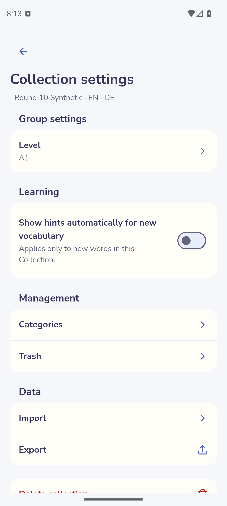

[Full image](images/r10-collection-settings.png) · [Metadata: `r10-collection-settings`](build-manifest.json) · [Related task](features.md#collections)
