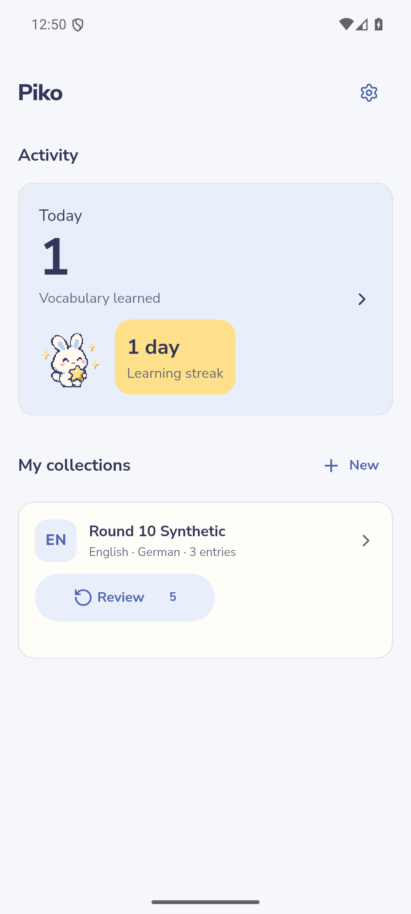
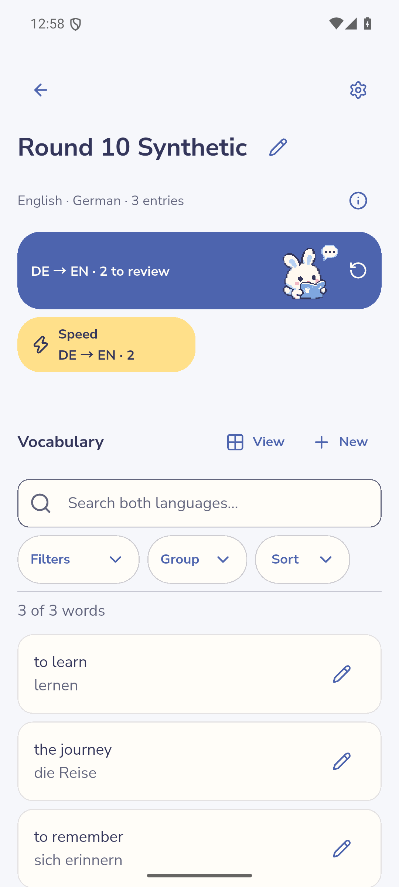
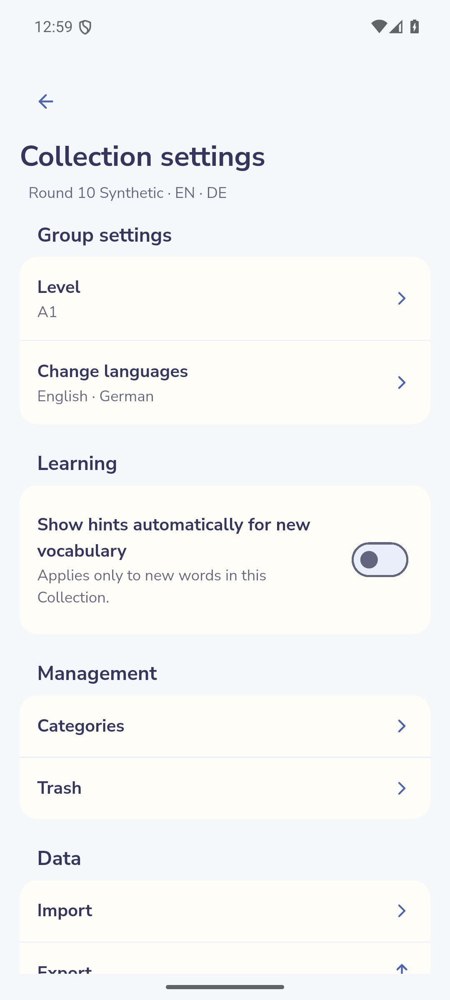
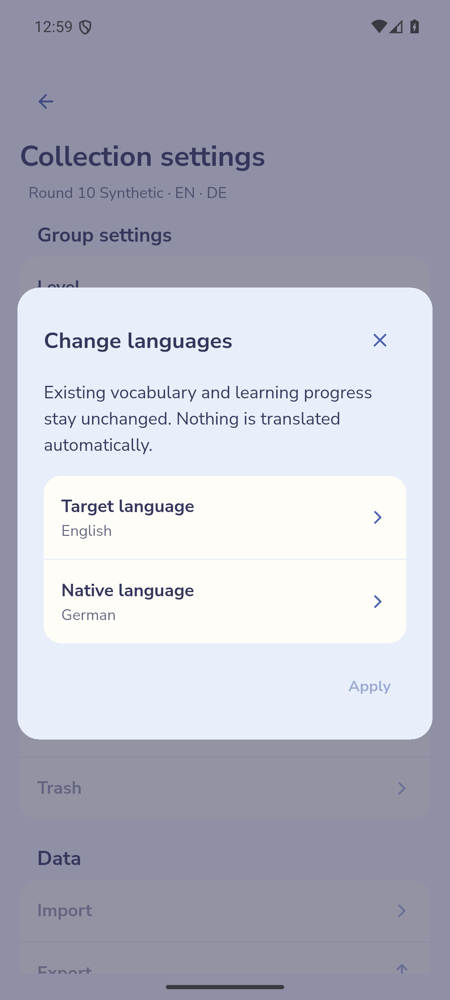

# Product screenshots

Original full captures of ordinary build **17**, identified by the [build manifest](build-manifest.json), including system UI. All four were captured on October 23, 2026 with English copy, normal text size and an Android API-36 emulator. The retained synthetic English/German Collection contains three vocabulary entries and existing learning statistics. Captures follow the schema-23 to schema-24 update through normal product navigation. The language editor is staged and was cancelled after capture. No crop, redaction or UI reconstruction is applied. [Verification coverage](verification.md) distinguishes ordinary-product observations, instrumented Android fixtures and remaining device gaps.

- [Collections](#collections)
- [Vocabulary editors and recovery](#editors)
- [Categories](#categories)
- [Selection](#selection)
- [Long-term learning](#learning)
- [Speed learning](#speed)
- [Statistics](#statistics)
- [JSON transfer](#transfer)
- [Settings](#settings)

## Collections

### Home Activity with retained learning statistics

[Full image](images/r11-home.png) · [Metadata: `r11-home`](build-manifest.json) · [Related task](features.md#statistics)

### Stacked bilingual Compact cards

[Full image](images/r11-collection.png) · [Metadata: `r11-collection`](build-manifest.json) · [Related task](features.md#collections)

## Vocabulary editors and recovery

See the [feature guide](features.md#edit-vocabulary) and [verification coverage](verification.md). No selected-build gallery capture is included for this flow.

## Categories

See the [feature guide](features.md#categories) and [verification coverage](verification.md). No selected-build gallery capture is included for this flow.

## Selection

See the [feature guide](features.md#selection) and [verification coverage](verification.md). No selected-build gallery capture is included for this flow.

## Long-term learning

See the [feature guide](features.md#long-term) and [verification coverage](verification.md). No selected-build gallery capture is included for this flow.

## Speed learning

See the [feature guide](features.md#speed) and [verification coverage](verification.md). No selected-build gallery capture is included for this flow.

## Statistics

The [Home Activity capture](#collections) shows retained learning statistics. See the [feature guide](features.md#statistics) and [verification coverage](verification.md) for behavior and tested scope.

## JSON transfer

See the [feature guide](features.md#transfer) and [verification coverage](verification.md). No selected-build gallery capture is included for this flow.

## Settings

### Collection Settings and language-change entrance

[Full image](images/r11-collection-settings.png) · [Metadata: `r11-collection-settings`](build-manifest.json) · [Related task](features.md#collections)

### Staged language editor

[Full image](images/r11-languages.png) · [Metadata: `r11-languages`](build-manifest.json) · [Related task](features.md#collections)
